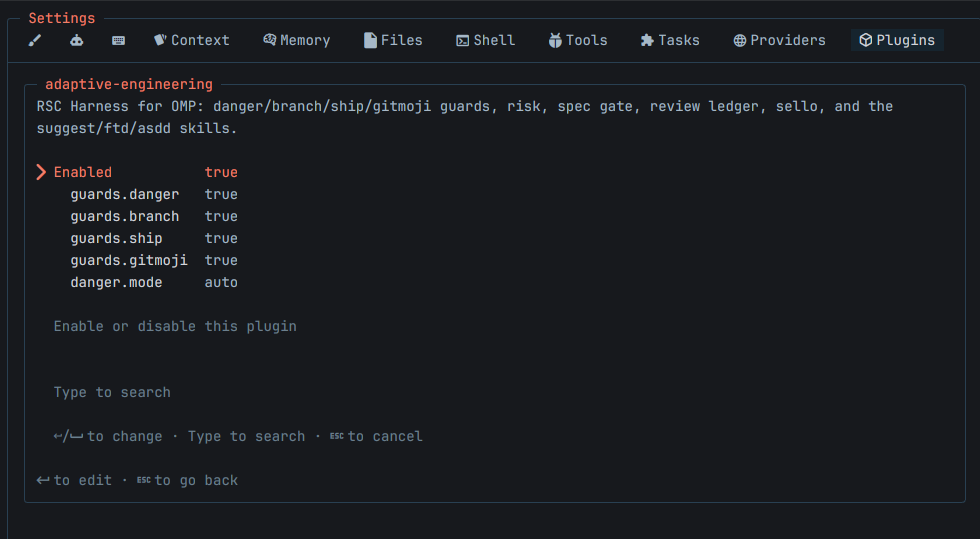

# Verification — Ajustes del plugin en la TUI de OMP — 2026-11-06 (r2)

> Segunda pasada del mismo día. La primera sigue en
> [plugin-settings-tui-2026-11-06.md](plugin-settings-tui-2026-11-06.md) con su verdict FAIL; esta la
> cierra con la evidencia que faltaba. Sin cambios de código entre ambas: lo que cambió es que alguien
> miró la página.

## Stack gate

- `node --test tests/*.test.js` → **PASS**: 198 tests, 197 pasan, 0 fallan, 1 omitido (`NO-APLICA`:
  deriva del estado de instalación, este checkout no tiene `.rsc/danger-guard.mjs`).
- `bun tests/adapter.test.ts` → **PASS**: seis secciones verdes, incluida la batería de referencia.

## Task done-checks

Todas las tareas T001–T014 siguen con su evidencia de la pasada anterior, sin cambios.

## Acceptance criteria (spec)

- [x] AC1 cinco filas — **verificado con captura**: 
  La página muestra `guards.danger`, `guards.branch`, `guards.ship`, `guards.gitmoji` y `danger.mode`,
  los cuatro primeros en `true` y el último en `auto`. El interruptor de enable queda aparte, como
  pedía la spec.
- [x] AC2–AC14 — sin cambios respecto de la pasada anterior; todas con salida de comando leída.

## Rollback plan

Sin cambios: `git revert` de los commits de la rama, o abandonarla. No hay migración ni estado nuevo.

## Capas no ejecutadas

- **NO-APLICA** — auditoría de dependencias: `package.json` no declara ninguna.
- **NO-APLICA** — deriva del estado de instalación: el fixture no existe en este checkout.
- Antes había una capa **SUSTITUIDA** (render por CLI). Ya no aplica: el render se verificó con la
  captura, que es el criterio real.

## Hallazgos descartados

- Ninguno.

## Verdict: PASS

Los 14 criterios tienen evidencia observable. La rama puede pasar a `review` de rama completa.
